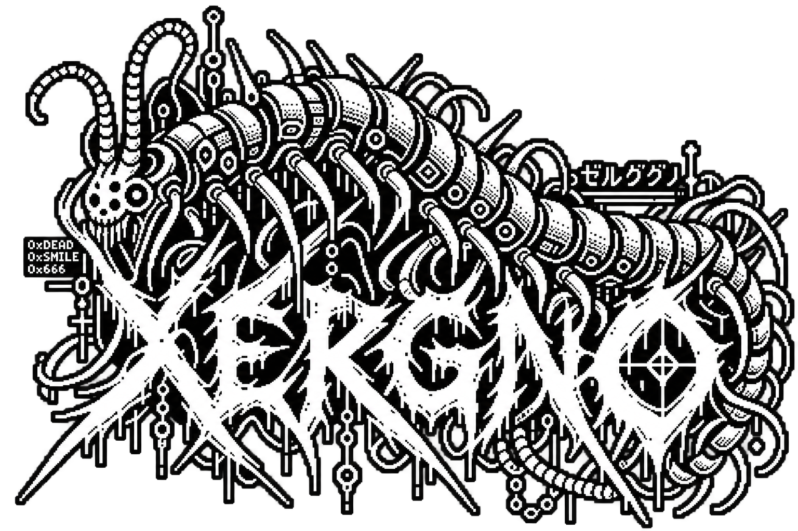

<div align="center">

<!-- Original artwork: unchanged file, displayed smaller using HTML width. -->


<code>vx66@deadsmile:~$ ./whoami</code>

### XERGNO / ゼルグノ

**PERSONAL HACKLAB · OLD MACHINES · STRANGE SOFTWARE**

<sub>REVERSE ENGINEERING // HOMEBREW // DOUJIN EXPERIMENTS // DENPA</sub>

[deadsmile.org](https://deadsmile.org/) &nbsp; / &nbsp; [source archive](https://github.com/vx66?tab=repositories) &nbsp; / &nbsp; [xergno](https://github.com/vx66)

</div>

---

### `01 // whoami` — 自己紹介

```console
xergno@deadsmile:~$ cat /etc/identity
handle       : xergno
host         : DEAD SMILE
location     : somewhere in Chile
occupation   : taking things apart / making strange things work
motto        : one broken thing at a time.

xergno@deadsmile:~$ echo $STATUS
still experimenting_ 
```

I'm **Xergno**. I like to take things apart, understand how they work, and make them do things they were never meant to do.

I write software, build homebrew for old hardware, mess with reverse engineering, and make small games and unusual web experiments. **DEAD SMILE** is my personal hacklab — not a company, just a place to document whatever I'm obsessed with lately.

A lot of my work lives somewhere between programming, Japanese underground culture, obsolete machines, and late-night curiosity.

### `02 // selected_experiments` — 制作物

| ID | Experiment | Notes |
|:--|:--|:--|
| `001` | **[Larp Reader](https://github.com/vx66/larp-reader)** | Native EPUB reader for the Sony PSP, written in C++17 / SDL2 and tested on real hardware. |
| `002` | **[Hit P-Chan!](https://github.com/vx66/hit-pchan)** | Pixel-art doujin-inspired browser game. Cute on the surface; not quite underneath. |
| `003` | **[Denpa Chat](https://github.com/vx66/denpa-chat)** | Ephemeral, privacy-focused browser chat experiment. |
| `004` | **[Baal](https://github.com/vx66/baal)** | Terminal-based network discovery and Wi-Fi device management tool. |
| `005` | **[Fastfetch Overdose](https://github.com/vx66/fastfetch-overdose)** | NEEDY GIRL OVERDOSE-inspired Fastfetch setup for Linux terminals. |
| `006` | **[DEAD SMILE](https://github.com/vx66/deadsmile)** | Retro terminal-styled microblog, technical writing, and experiments. |

### `03 // things_i_work_with` — 開発環境

<sub>LANGUAGES</sub>

<p>
  
  
  
  
  
  
  
</p>

<sub>FRAMEWORKS / RUNTIMES</sub>

<p>
  
  
  
  
  
  
  
</p>

<sub>SYSTEMS / TOOLS</sub>

<p>
  
  
  
  
  
  
  
</p>

<sub>Badges by [Shields.io](https://shields.io/) using [Simple Icons](https://simpleicons.org/) where available.</sub>

### `04 // obsessions.txt` — 執着

```text
[01] old computers, dead consoles, and PSP homebrew
[02] reverse engineering, strange software, Linux / Unix
[03] visual novels, denpa, doujin culture, obscure Japanese media
[04] Japanese horror movies and horror games
[05] noisy music, breakcore, and other sounds that probably annoy people
[06] pixel art, retro interfaces, fanzines, and digital ruins
```

### `05 // transmission` — 通信

```console
xergno@deadsmile:~$ cat /var/log/last_message
NO LOVE IN THE DEEP WEB.

one broken thing at a time.
```

<div align="center">

<sub>「また、どこかで。」 — see you somewhere, sometime.</sub>

**[DEADSMILE.ORG](https://deadsmile.org/)**

</div>
